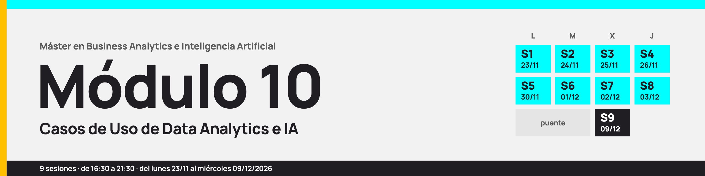
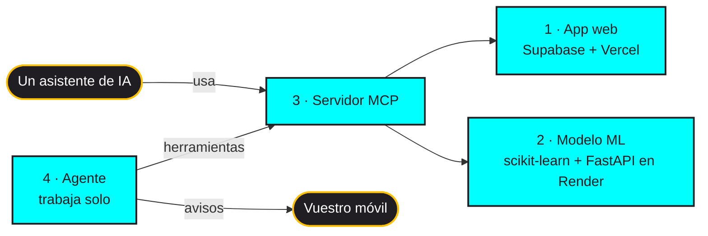

  

  
  
  
  

**Bienvenidos al Módulo 10.** Nueve tardes y un proyecto individual, con datos reales y algo que predecir. Al final tendréis cuatro piezas funcionando en internet: una app web con vuestros datos, vuestro propio modelo servido como API, un servidor MCP para que una IA use los dos y un agente que trabaja solo y os avisa al móvil.

Cada tarde construyo en directo la pieza del día sobre mi proyecto de demostración, **"Pisos Madrid"**, y vosotros la aplicáis al vuestro esa misma tarde. Cada pieza acaba con su URL pública: **si no tiene URL, no existe.**

## La hoja de ruta

| | Fecha | Sesión | Pieza |
|:-:|---|---|---|
| **S1** | lun 23/11 | **De cero a URL** GitHub, tu agente de programación, Vercel. Idea aprobada y primera página publicada | |
| **S2** | mar 24/11 | **Tu app con datos** Supabase + Vercel, con login | 1 · App web |
| **S3** | mié 25/11 | **Tu modelo como servicio** scikit-learn, FastAPI, Render | 2 · Modelo |
| **S4** | jue 26/11 | **Every SaaS needs an MCP** comprobación: vuestras tres URLs | 3 · MCP |
| **S5** | lun 30/11 | **Agentes que trabajan solos** | 4 · Agente |
| **S6** | mar 01/12 | **Elige el cerebro y dale herramientas** | 4 · Agente |
| **S7** | mié 02/12 | **Que no te lo rompan** seguridad, revisión cruzada en parejas | |
| **S8** | jue 03/12 | **Autoevaluación y revisión** entregáis el documento de autoevaluación; revisión de 3 minutos conmigo | |
| | 04 a 08/12 | *Puente* | |
| **S9** | mié 09/12 | **Presentaciones** 8 minutos, obligatorias y presenciales, con turno fijo | |

### Cada tarde

| Hora | Qué pasa |
|---|---|
| **16:30** | Apertura: el "truco del día", 10 minutos. Empieza en punto y no se repite |
| 16:40 | Demo de la pieza del día sobre Pisos Madrid |
| 17:05 | Construir: la aplicáis a vuestro proyecto, conmigo pasando por las mesas |
| 18:00 | Descanso hasta las 18:30 |
| 18:30 | Seguimos construyendo |
| 21:00 | Stand-up de proceso: tres personas cuentan qué pidieron a la IA, qué falló y cómo lo arreglaron |
| **21:15** | Cada uno publica la URL de su avance |

## Empieza aquí

Para no gastar la primera tarde en registros, traed esto hecho. Usad un **email personal**, no el de Inesdi: son cuentas que os vais a quedar. Todo tiene plan gratuito; si algo os pide tarjeta, parad y lo vemos en clase.

- [ ] **Portátil cargado** y con permiso para instalar programas. Si es de empresa y no os deja, avisadme.
- [ ] Cuenta en **GitHub** e instalar **Git**.
- [ ] Cuentas en **Vercel**, **Supabase** y **Render**, entrando con "Continue with GitHub".
- [ ] **Un agente de programación con IA.** Si no sabéis cuál, **OpenCode**: es gratis y es el que usan las guías. Si ya usáis otro, también vale.
- [ ] **Una o varias ideas de proyecto:** un tema con datos reales y algo que predecir. En bruto vale; la cerramos juntos.

**Cuentas y herramientas**

  
  
  
  
  

**Agentes de programación** (uno basta)

  
  
  
  
  
  
  

Los prompts del módulo funcionan en cualquiera. Si vuestro agente no lee `AGENTS.md` solo, empezad vuestros prompts con "Lee AGENTS.md". La guía paso a paso del setup está en el aula virtual.

¿Algo no os sale? Venid igualmente y lo resolvemos en clase.

## La arquitectura

Cuatro piezas (en cian, lo vuestro), cada una con su URL pública.

1. **App web con vuestros datos** · S2. Supabase guarda los datos y el login; Vercel publica la app desde GitHub.
2. **Vuestro modelo como API** · S3. Un modelo de machine learning propio con scikit-learn, servido con FastAPI en Render y usado desde la app. Se evalúa de forma honesta: se entrena con lo antiguo y se comprueba con lo que el modelo no ha visto.
3. **Servidor MCP** · S4. Every SaaS needs an MCP: así una IA puede buscar en vuestros datos y usar vuestro modelo cuando le habláis en lenguaje natural.
4. **Agente que trabaja solo** · S5 y S6. Se ejecuta a su hora, usa vuestro MCP como herramienta y os manda avisos al móvil. Elegís su cerebro y comparáis modelos.

Alrededor de las piezas: la seguridad (S7), con las claves fuera del código y una revisión cruzada en parejas.

**Lo mínimo para aprobar:** la app con datos, el modelo como API y el MCP funcionando y accesibles el 09/12. El agente suma nota.

## ¿Sin idea todavía?

- **Paco**, vuestro sparring: un prompt para cualquier chat de IA (vale el gratis) que os saca la idea, busca datos reales en Kaggle y en datos abiertos y, si queréis, os dibuja un mapa aproximado del proyecto con un primer `AGENTS.md`. Está en el aula virtual (`sparring-paco.md`).
- **Si a las 20:30 del lunes no tenéis idea aprobada**, elegís una de estas temáticas de ejemplo. Pisos Madrid no está en la lista: es mi demo y lo vais a ver entero.

| Temática | Qué predecir | Datos (licencia) |
|---|---|---|
| Aire de Madrid | El NO2 de mañana en cada estación | [Calidad del aire, datos horarios desde 2001](https://datos.madrid.es/dataset/201200-0-calidad-aire-horario), Ayuntamiento de Madrid (CC BY 4.0) |
| BiciMAD | Los usos de mañana | [BiciMAD: altas de usuarios y usos por día](https://datos.madrid.es/dataset/213155-0-bicimad-usos-usuarios), Ayuntamiento de Madrid (CC BY 4.0) |
| Tienda online | Las unidades de cada producto la semana que viene | [Online Retail II](https://archive.ics.uci.edu/dataset/502/online+retail+ii), UCI (CC BY 4.0) |
| Campaña de un banco | Si un cliente contratará el depósito | [Bank Marketing](https://archive.ics.uci.edu/dataset/222/bank+marketing), UCI (CC BY 4.0) |
| Luz de casa | El consumo de mañana | [Individual Household Electric Power Consumption](https://archive.ics.uci.edu/dataset/235/individual+household+electric+power+consumption), UCI (CC BY 4.0) |

Más datos abiertos: [Kaggle Datasets](https://www.kaggle.com/datasets) y [datos.gob.es](https://datos.gob.es).

## Cómo se evalúa

La nota es **100 % el proyecto**. Los detalles y la ponderación están en la Guía Docente, en el aula virtual.

- **Jueves 03/12, en clase:** entregáis vuestro **documento de autoevaluación**, con todas las preguntas de la plantilla respondidas (no hace falta entregar código ni despliegue). Es también el guion de vuestra presentación. Ese día tenemos una revisión de 3 minutos, sin nota: os digo si llegáis al mínimo para aprobar y, si no, qué os falta.
- **Miércoles 09/12: presentaciones, obligatorias y presenciales.** 8 minutos cada uno, con turno fijo. Presentáis lo que dice vuestra autoevaluación.
- **Causa justificada** (médica o de fuerza mayor): presentación alternativa online antes del 15/12, con nota máxima de 8. Quien no presente sin causa justificada va a la actividad de recuperación.

Ojo con el puente del 4 al 8 de diciembre: no hagáis planes que os impidan estar aquí el 9 a las 16:30.

## Dónde vive cada cosa

| Qué | Dónde |
|---|---|
| Vuestro proyecto | Un repo en vuestra cuenta personal de GitHub, con acceso para mí. Una carpeta por pieza: `web/`, `api/`, `mcp/`, `agente/`, y un `AGENTS.md` en la raíz |
| "Pisos Madrid", mi proyecto de demostración | Aquí, en esta organización, con una etiqueta por sesión |
| Materiales de cada sesión | En el aula virtual, en PDF; las diapositivas, al día siguiente de cada sesión |

**[Ver los repositorios del curso →](https://github.com/orgs/inesdi-m10-ia-2026-11/repositories)**

Organización del curso creada por el docente; no es la cuenta oficial de Inesdi.
